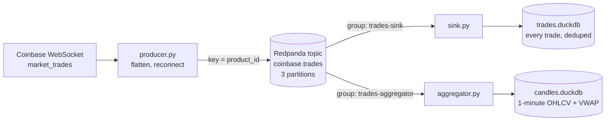

# coinbase-trades-stream

A small streaming pipeline that takes live crypto trades from Coinbase's public WebSocket feed, sends them through Kafka (Redpanda), and processes them in two ways: a sink that stores every raw trade, and an aggregator that builds 1-minute candles in real time.

This is a learning and portfolio project. It runs locally on one Redpanda broker with three trading pairs, so it isn't sized or tested for production load. The goal was hands-on practice with the parts of streaming that are hard to get right: partitioning, offset commits, duplicates, reconnects, event time and late data. The [experiments](docs/experiments.md) test that behavior by breaking things on purpose.

## Architecture



| Component | What it does |
|---|---|
| **Producer** | Subscribes to `market_trades` for BTC-USD, ETH-USD and SOL-USD. Splits each WebSocket message into one Kafka message per trade, keyed by `product_id`. Reconnects with exponential backoff and treats a silent connection as dead. |
| **Sink** | Consumes in batches of up to 500 and writes every trade to DuckDB with idempotent inserts. Commits Kafka offsets only after the database write succeeds. |
| **Aggregator** | Builds 1-minute candles (open, high, low, close, volume, VWAP) per product by event time. Uses a watermark to decide when a minute is complete, drops and counts late trades, and only commits offsets that are safe to recover from. |

The two consumers use separate consumer groups, so each reads the full stream independently at its own pace.

**Stack:** Python 3.11, Redpanda (Kafka API) and Redpanda Console in Docker Compose, `confluent-kafka`, `websockets`, DuckDB, pytest, ruff, GitHub Actions.

## Running it

**Prerequisites:** Docker Desktop and Python 3.11.

1. Start Redpanda and the Console, then create the topic:

   ```bash
   docker compose up -d
   docker compose exec redpanda rpk topic create coinbase.trades -p 3
   ```

2. Create a virtual environment and install the dependencies:

   ```bash
   python -m venv .venv
   .venv\Scripts\Activate.ps1        # Windows PowerShell
   # source .venv/bin/activate      # macOS / Linux
   pip install -r requirements.txt
   ```

3. Run each process in its own terminal:

   ```bash
   python -m coinbase_stream.producer
   python -m coinbase_stream.sink
   python -m coinbase_stream.aggregator
   ```

4. Look around:
   - Redpanda Console at http://localhost:8080 shows topics, partitions and messages.
   - Consumer lag: `docker compose exec redpanda rpk group describe trades-sink`
   - Data: stop a consumer first, because DuckDB lets only one process write to a file at a time, then query its file:

     ```bash
     python -c "import duckdb; print(duckdb.connect('data/candles.duckdb', read_only=True).sql('select * from candles order by window_start desc limit 10'))"
     ```

Settings that depend on where the code runs (broker address, topic, products, data directory) live in [`config.py`](coinbase_stream/config.py) and can be overridden with environment variables such as `BOOTSTRAP_SERVERS` and `PRODUCTS`.

## Design decisions

**Partition key: `product_id`.** Kafka keeps order within a partition, and a key always maps to the same partition. Keying by product keeps each product's trades in order and lets a single consumer see all of a product's trades, which a candle needs. Keying by `trade_id` would scatter each product across every partition. The key is chosen for grouping, not uniqueness. Uniqueness is the database's job.

**One message per trade.** One Coinbase message can hold several trades, listed newest first. The producer flattens them, sends them oldest first, and adds metadata that would otherwise be lost: `event_type` (snapshot or update), `exchange_ts` (when Coinbase sent the message), `sequence_num`, and `received_at` (when the producer got it). Prices and sizes stay strings until the consumers parse them as `DECIMAL`, so floating-point rounding never touches them.

**Reconnects.** Network errors trigger a reconnect with exponential backoff and full jitter, capped at 30 s. The backoff resets only after a connection has stayed up for 60 s, so a server that accepts connections and then drops them right away can't cause a tight retry loop. If no message arrives for 30 s, the connection is treated as dead. Bugs in the code, like a `KeyError`, are not caught and crash the producer instead of retrying forever.

**At-least-once delivery with idempotent writes.** Auto-commit is off. The sink writes a batch in one DuckDB transaction and only then commits offsets, so a crash in between causes redelivery rather than loss. Duplicates come from two sources, redelivery and the snapshot Coinbase sends again on every reconnect. Both are absorbed by `PRIMARY KEY (product_id, trade_id)` with `ON CONFLICT DO NOTHING`. The stored results are effectively exactly-once.

**Event time, watermarks and late data.** A trade belongs to the minute of its exchange `time`, not the minute it arrived. Open and close are the earliest and latest trades by event time, with `trade_id` breaking ties, not the first and last to arrive. Each product has a watermark: the latest event time seen, minus 5 s of allowed lateness. Once the watermark passes the end of a window, the candle is final and written. Trades that arrive after their window was written are dropped and counted. Duplicates inside an open window are skipped using a per-candle set of trade IDs.

**Crash-safe aggregator offsets.** Open candles only exist in memory, so the aggregator never commits past the oldest trade still in an open window. After a crash, Kafka replays those trades and the candles are rebuilt. On startup, the aggregator sets each product's watermark from the last candle in the table, so replayed trades for windows already written are skipped instead of overwriting complete candles with partial ones.

**Fast path and complete path.** The candles are fast but can miss late trades. The sink has no windows, so it keeps every trade, including late ones and trades recovered from reconnect snapshots. Rebuilding candles from the `trades` table in SQL would give exact results to check the streaming ones against.

## Experiments

[docs/experiments.md](docs/experiments.md) has the full write-ups with numbers. In short:

1. **Crash between the DB write and the offset commit.** The committed offsets didn't move. On restart, the first batch was 500 messages, only 148 of them new. The other 352 were redelivered and skipped by the primary key. No trades were lost or duplicated. The crashed consumer also stayed listed as a group member until its session timeout ran out.
2. **Replay after a bug.** A VWAP bug corrupted all 36 candles. After deleting the derived table and rewinding the consumer group with `rpk group seek --to start`, the whole topic replayed, and every rebuilt candle passed the check.
3. **Rebalancing.** With 4 consumers and 3 partitions, one consumer got nothing. Skewed keys left one consumer with about 3× the traffic of another while a third sat on the empty partition. Every rebalance revoked every partition, and the range assignor moved consumers that weren't the ones joining or leaving.

## Known limitations

- **Partition skew.** Three keys over three partitions collided: BTC-USD and SOL-USD share partition 2, and partition 1 is empty. Hashing only spreads keys evenly when there are many of them.
- **A quiet product stalls its watermark.** If a product has no trades, its latest candle doesn't close. An idle timeout or heartbeats could move the watermark forward.
- **Late trades are dropped from candles.** This includes trades missed during a disconnect that come back in the reconnect snapshot. They are still in the `trades` table.
- **The aggregator only works as a single instance.** Its state lives in memory, and a rebalance would move partitions away without moving the state.
- **Long outages lose data.** The reconnect snapshot only covers recent trades. Anything older than it never reaches the pipeline.
- **No schema validation.** Messages are plain dicts. A change in Coinbase's format would surface as a `KeyError` deep in a consumer.

## What I'd do next

- Validate messages with pydantic at the producer and consumers, and send malformed ones to a dead-letter table.
- Switch to the `cooperative-sticky` assignor, and flush or hand off aggregator state in `on_revoke` so it can run as several instances.
- Add a batch job that rebuilds candles from `trades` and reports how often late data changes them.
- Backfill gaps after long outages from Coinbase's REST trades endpoint.
- Advance watermarks for idle products.
- Use a schema registry (Avro or Protobuf) for the topic.
- Run the producer and consumers in Docker Compose too, using the internal listener (`BOOTSTRAP_SERVERS=redpanda:9092`).
- Export metrics: consumer lag, late-trade counts, and the gaps between exchange time, receive time and consume time.

## Tests and CI

```bash
pip install -r requirements-dev.txt
ruff check .
pytest
```

The unit tests cover the pure logic, which needs no broker or network: flattening and ordering trades, backoff bounds, converting messages to rows (using a fake Kafka message), and the aggregator (open and close by event time, volume and VWAP, deduplication, the lateness allowance, dropping late trades, and safe offsets). GitHub Actions runs ruff and pytest on every push and pull request.

## License

MIT
