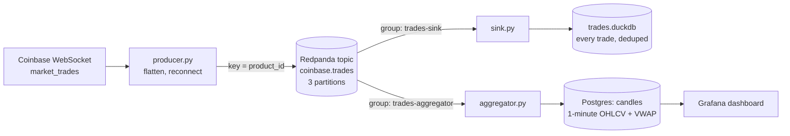
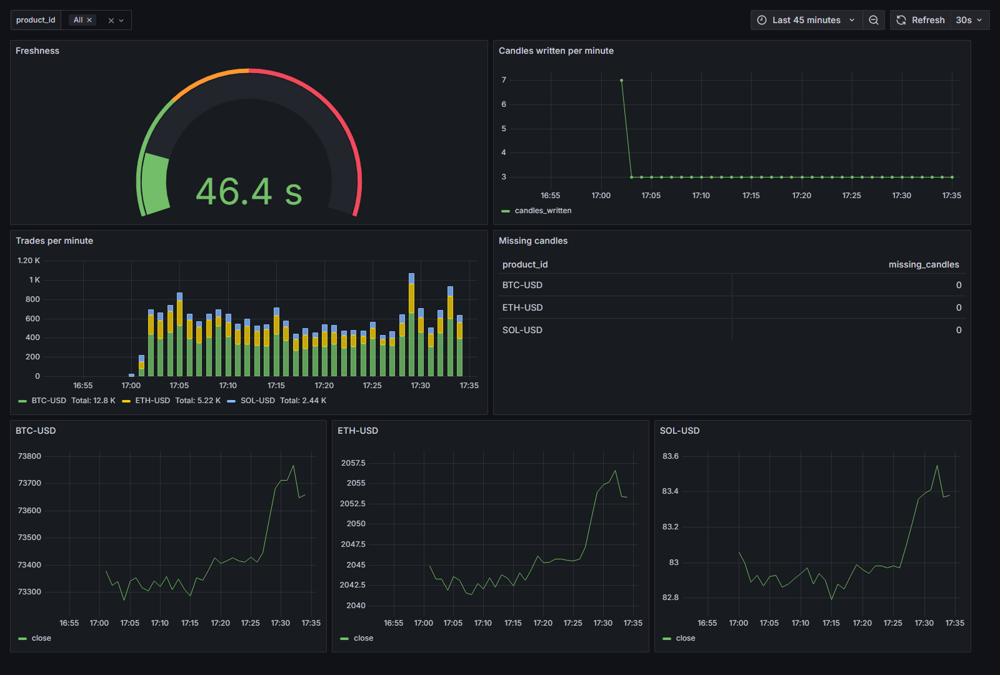

# coinbase-trades-stream

A small streaming pipeline that takes live crypto trades from Coinbase's public WebSocket feed, sends them through Kafka (Redpanda), and processes them in two ways: a sink that stores every raw trade, and an aggregator that builds 1-minute candles in real time. A Grafana dashboard shows the candles and the pipeline's health.

This is a learning and portfolio project. It runs locally on one Redpanda broker with three trading pairs, so it isn't sized or tested for production load. The goal was hands-on practice with the parts of streaming that are hard to get right: partitioning, offset commits, duplicates, reconnects, event time and late data. The [experiments](docs/experiments.md) test that behavior by breaking things on purpose.

## Architecture





| Component | What it does |
|---|---|
| **Producer** | Subscribes to `market_trades` for BTC-USD, ETH-USD and SOL-USD. Splits each WebSocket message into one Kafka message per trade, keyed by `product_id`. Reconnects with exponential backoff and treats a silent connection as dead. |
| **Sink** | Consumes in batches of up to 500 and writes every trade to DuckDB with idempotent inserts. Commits Kafka offsets only after the database write succeeds. |
| **Aggregator** | Builds 1-minute candles (open, high, low, close, volume, VWAP) per product by event time. Uses a watermark to decide when a minute is complete, drops and counts late trades, and only commits offsets that are safe to recover from. Writes candles to Postgres with an upsert. |
| **Dashboard** | Grafana reads the candles from Postgres: freshness, trades per minute, candles written per minute, missing minutes, and price per product. The datasource and dashboard are provisioned from files in `grafana/`. |

The two consumers use separate consumer groups, so each reads the full stream independently at its own pace.

**Stack:** Python 3.11, Redpanda (Kafka API), Redpanda Console, Postgres and Grafana in Docker Compose, `confluent-kafka`, `websockets`, `psycopg`, DuckDB, pytest, ruff, GitHub Actions.

## Running it

**Prerequisites:** Docker Desktop and Python 3.11.

1. Copy `.env.example` to `.env` and set the passwords. Docker Compose and `config.py` both read it, and it's gitignored.

2. Start Redpanda, the Console, Postgres and Grafana, then create the topic:

   ```bash
   docker compose up -d
   docker compose exec redpanda rpk topic create coinbase.trades -p 3
   ```

3. Create a virtual environment and install the dependencies:

   ```bash
   python -m venv .venv
   .venv\Scripts\Activate.ps1        # Windows PowerShell
   # source .venv/bin/activate      # macOS / Linux
   pip install -r requirements.txt
   ```

4. Run each process in its own terminal:

   ```bash
   python -m coinbase_stream.producer
   python -m coinbase_stream.sink
   python -m coinbase_stream.aggregator
   ```

5. Look around:
   - Grafana at http://localhost:3000 (user `admin`, password from `.env`). The **Coinbase Candles** dashboard is in the Coinbase folder.
   - Redpanda Console at http://localhost:8080 shows topics, partitions and messages.
   - Consumer lag: `docker compose exec redpanda rpk group describe trades-sink`
   - Candles:

     ```bash
     docker compose exec postgres psql -U coinbase -d coinbase -c "select * from candles order by window_start desc limit 10"
     ```

   - Raw trades: stop the sink first, because DuckDB lets only one process open a file for writing, then query its file:

     ```bash
     python -c "import duckdb; print(duckdb.connect('data/trades.duckdb', read_only=True).sql('select * from trades order by trade_time desc limit 10'))"
     ```

Settings that depend on where the code runs (broker address, topic, products, data directory, Postgres connection) live in [`config.py`](coinbase_stream/config.py) and can be overridden with environment variables such as `BOOTSTRAP_SERVERS`, `PRODUCTS` and `POSTGRES_HOST`. `config.py` also loads `.env`.

## Experiments

[docs/experiments.md](docs/experiments.md) has the full write-ups with numbers. In short:

1. **Crash between the DB write and the offset commit.** The committed offsets didn't move. On restart, the first batch was 500 messages, only 148 of them new. The other 352 were redelivered and skipped by the primary key. No trades were lost or duplicated. The crashed consumer also stayed listed as a group member until its session timeout ran out.
2. **Replay after a bug.** A VWAP bug corrupted all 36 candles. After deleting the derived table and rewinding the consumer group with `rpk group seek --to start`, the whole topic replayed, and every rebuilt candle passed the check.
3. **Rebalancing.** With 4 consumers and 3 partitions, one consumer got nothing. Skewed keys left one consumer with about 3× the traffic of another while a third sat on the empty partition. Every rebalance revoked every partition, and the range assignor moved consumers that weren't the ones joining or leaving.

## Known limitations

- **Partition skew.** BTC-USD and SOL-USD hash to the same partition, and partition 1 is empty.
- **Single-instance aggregator.** Candle state lives in memory, so a rebalance would lose it.
- **Late trades are dropped from candles**, though the sink still stores them. A quiet product also stalls its watermark.
- **Long outages lose data** older than the reconnect snapshot.
- **No schema validation.** A change in Coinbase's message format would surface as a `KeyError`.

## Next steps

- Validate messages with pydantic and send bad ones to a dead-letter table.
- Use the `cooperative-sticky` assignor and hand off aggregator state on rebalance.
- Rebuild candles from `trades` in batch to measure how much late data changes them.
- Grafana alerts on freshness, and a read-only Postgres role for the dashboard.

## Tests and CI

```bash
pip install -r requirements-dev.txt
ruff check .
pytest
```

The unit tests cover the pure logic, which needs no broker, database or network: flattening and ordering trades, backoff bounds, converting messages to rows (using a fake Kafka message), and the aggregator (open and close by event time, volume and VWAP, deduplication, the lateness allowance, dropping late trades, and safe offsets). GitHub Actions runs ruff and pytest on every push and pull request.

## License

MIT
